# 00 — Executive Summary

## System Overview & Purpose

The **Odoo Data Extraction & Analytics Pipeline** is an automated Python-based ETL (Extract, Transform, Load) system designed to bridge an enterprise **Odoo ERP** (cloud/hosted instance) with a centralized **PostgreSQL Data Warehouse** (`EBIZFRAME_BI` / `odoo_roshni`). The data warehouse provides clean, normalized, and pre-aggregated transactional datasets for **Power BI** dashboards, financial reporting, inventory valuation, sales tracking, and executive decision-making.

Direct PostgreSQL database access to hosted Odoo instances is frequently restricted due to security and multi-tenant cloud governance. This project solves that operational bottleneck by establishing an automated, API-driven ELT pipeline using Odoo's JSON-RPC and XML-RPC endpoint protocols (`/jsonrpc` and `object.execute_kw`). It extracts subledger transactions across 5 core enterprise business domains—**Masters**, **Sales**, **Purchase**, **Inventory**, and **Finance**—transforms them into target enterprise schema contracts, bulk-loads them into isolated staging tables, and idempotently merges them via target PostgreSQL stored procedures.

---

## Review Profile & Review Metadata

| Attribute | Value / Evidence |
| :--- | :--- |
| **Review Date** | November 2, 2026 |
| **Repository Root** | `D:\ARYAN GUPTA OLD LAPTOP BACKUP\PROJECTS\ODOO ERP Research` |
| **Primary Language** | Python 3.11.5 |
| **Target Database** | PostgreSQL 18.x (Remote host `161.118.176.229:5433`, schema `EBIZFRAME_BI`) |
| **Source System** | Odoo ERP (Roshni Distributors Ltd, `roshni13.odoo.com`) |
| **Total Ingested Volume** | 34,722 records across 18 operational tables (verified in live target DB) |
| **Review Tooling** | Static AST inspection, file inventory, runtime verification, psycopg2 query traces |
| **Scope Limitations** | Read-only evaluation; live Odoo API calls performed only for schema verification |

---

## Architecture at a Glance

The pipeline operates on a robust **Staging-and-Merge ELT Pattern**:

```mermaid
flowchart LR
    subgraph Source ["Source Layer (Odoo Cloud ERP)"]
        OdooAPI["Odoo 16/17 ERP<br/>(JSON-RPC / XML-RPC)"]
        res_partner[res.partner]
        account_move[account.move]
        account_move_line[account.move.line]
        stock_quant[stock.quant]
        purchase_order_line[purchase.order.line]
        OdooAPI --> res_partner
        OdooAPI --> account_move
        OdooAPI --> account_move_line
        OdooAPI --> stock_quant
        OdooAPI --> purchase_order_line
    end

    subgraph Pipeline ["ETL Pipeline Engine (Python 3.11)"]
        Runner["CLI Orchestrator<br/>(run_pipeline.py)"]
        Connector["OdooClient<br/>(connector.py)"]
        Extractors["Domain Extractors (18)<br/>(pipelines/*)"]
        Loader["DWHLoader<br/>(db_loader.py)"]
        
        Runner --> Connector
        Runner --> Extractors
        Extractors --> Connector
        Extractors --> Loader
    end

    subgraph DWH ["Target Data Warehouse (PostgreSQL)"]
        TempTables[("{TABLE}_TEMP<br/>Staging Tables")]
        Procedures["Stored Procedures (21)<br/>(sp_update_*)"]
        TargetTables[("{TABLE}<br/>Analytical Tables (18)")]
        PowerBI["Power BI &<br/>Reporting Analytics"]

        Loader -- "execute_values<br/>with 'Call ID'" --> TempTables
        Loader -- "CALL sp_update_*(p_call_id)" --> Procedures
        TempTables --> Procedures
        Procedures -- "Idempotent Merge<br/>(Delete by Key + Insert)" --> TargetTables
        TargetTables --> PowerBI
    end

    Source --> Pipeline
```

---

## Top 5 Strengths of the Codebase

1. **Deterministic Idempotent Ingestion**: Data is never inserted blindly. Instead, incoming rows are tagged with a unique batch identifier (`Call ID`), loaded into dedicated staging tables (`{TABLE}_TEMP`), and merged using PostgreSQL stored procedures (`sp_update_*`) that delete matching business keys before inserting. Reruns never produce duplicate records.
2. **High-Throughput Bulk Ingestion**: The database loader (`db_loader.py`) uses `psycopg2.extras.execute_values` with a page size of 1,000, streaming tens of thousands of rows to remote PostgreSQL instances in seconds rather than row-by-row `INSERT` operations.
3. **Pluggable Extractor Registry Pattern**: All domain extractors inherit from a common abstract base (`BaseExtractor` in `pipelines/base.py`) providing standardized interfaces, common type conversion/safe casting utilities, and uniform execution logging.
4. **Metadata Discovery and Reflection**: The codebase includes dedicated introspection scripts (`fetch_odoo_tables.py`, `fetch_table_column_metadata.py`) that reflect live Odoo data models into structured CSV dictionaries (2,584 verified columns across 25 tables), preventing blind mapping guesses.
5. **Enriched Relationship Mapping**: Extractors intelligently traverse Odoo many2one and related model hierarchies—enriching Sales Lines with parent invoice salespersons (`invoice_user_id`), Purchase Lines with physical GRN picking tickets and vendor bills, and Product items with 3-level category trees.

---

## Top 5 Risks & Technical Debt

1. **Unbounded Table Scan Risk on Multi-Million Row Models**: Odoo's live instance contains over **1.62 million sales lines** and **5.26 million GL items**. Without explicit date watermarking or chunked offset pagination, unbounded extractions will trigger HTTP `Read timed out` exceptions.
2. **Sensitive Plain-Text Credentials in Repository Trees**: A historical file (`Documents/odoo credentials.txt`) and `.env` contain active connection strings and API passwords. While `.gitignore` was configured, credential rotation and secret manager adoption remain high priorities.
3. **Absence of an Automated Pytest / CI Testing Suite**: Current testing relies on ad-hoc scripts in `MISC/` rather than automated unit test fixtures or CI/CD test gates.
4. **Lack of Dynamic Connection Pooling**: `db_loader.py` creates and terminates dedicated `psycopg2` connections per extractor. While sufficient for sequential batch runs, high-concurrency orchestrations require a managed connection pool (`psycopg2.pool`).
5. **Legacy Hardcoded Schema References in DDL Backups**: Historical database dumps (`DAL_BKP_08042026`) contain legacy references to schema `"EVA_BI"`. While `setup_db.py` dynamically cleans and adapts this to `EBIZFRAME_BI`, standalone manual execution of SQL scripts could collide if not filtered.

---

## Qualitative Maintainability & Operational Scorecard

| Dimension | Rating | Key Evidence & Rationale |
| :--- | :---: | :--- |
| **Architecture Cleanliness** | **A-** | Clear modular separation: Transport (`connector.py`), Config (`config.py`), Persistence (`db_loader.py`), Extraction (`pipelines/`). |
| **Schema & Data Integrity** | **A** | 100% column matching between `Table_references.sql` and Python output dictionaries across all 18 tables. Staging tables prevent half-written batches. |
| **Extensibility** | **A** | Adding a new extractor requires only subclassing `BaseExtractor`, defining `target_table`, and registering it in `run_pipeline.py`. |
| **Operational Simplicity** | **B+** | CLI commands (`run_pipeline.py --domain all --load`) are straightforward, with built-in `--truncate` and `--limit` overrides. |
| **Automated Test Coverage** | **C** | High manual/runtime verification, but 0% automated unit/mock test coverage. |
| **Security Posture** | **B-** | Environment variable support exists, but legacy cleartext credential files in `Documents/` require sanitization. |

---

## Highest Priority Actions (Roadmap)

| Priority | Action Item | Target Component | Expected Impact |
| :---: | :--- | :--- | :--- |
| **P0** | Purge `Documents/odoo credentials.txt` and rotate the Odoo and PostgreSQL passwords. | `Documents/`, `.env` | Eliminates critical credential leakage risk. |
| **P1** | Implement incremental date watermarking (`--start-date`) and chunked cursor pagination in `sales_data.py` and `transaction.py`. | `pipelines/sales/`, `pipelines/finance/` | Prevents Odoo API timeouts when ingesting >1.6M rows. |
| **P2** | Introduce a formal `pytest` suite with mocked Odoo JSON-RPC responses for CI validation. | `tests/` | Guarantees regression protection during future refactoring. |
| **P3** | Package database initialization into formal Alembic or Flyway database migrations. | `setup_db.py`, `sql/` | Standardizes DDL versioning across environments. |

---

## Document Navigation Guide

This review contains 12 interconnected modules providing a complete technical orientation:

1. [System Context and Purpose](01-system-context-and-purpose.md)
2. [Architecture and Components](02-architecture-and-components.md)
3. [Runtime Flows and Data Flow](03-runtime-flows-and-data-flow.md)
4. [Module and Interface Catalog](04-module-and-interface-catalog.md)
5. [Configuration, Integrations, and Data](05-configuration-integrations-and-data.md)
6. [Testing, Quality, and Build](06-testing-quality-and-build.md)
7. [Security Review](07-security-review.md)
8. [Reliability and Operations](08-reliability-and-operations.md)
9. [Developer Knowledge Transfer (KT) Guide](09-developer-kt-guide.md)
10. [Risks, Decisions, and Open Questions](10-risks-decisions-and-open-questions.md)
11. [Glossary](11-glossary.md)

