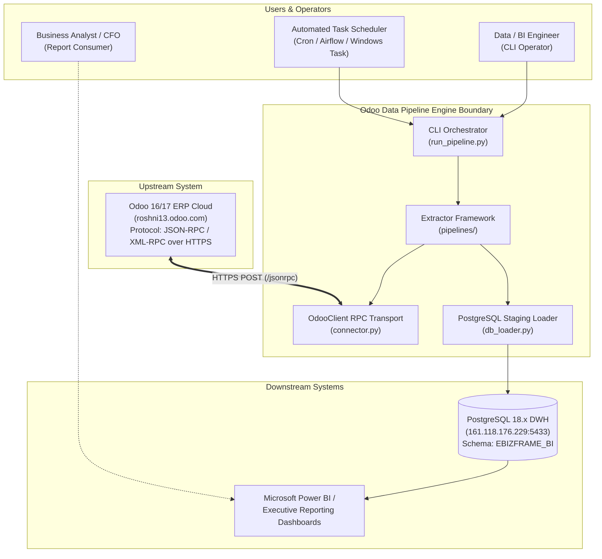

# 01 — System Context and Purpose

## 1. Business & Technical Problem Solved

Modern mid-market and enterprise organizations operating on **Odoo ERP** require consolidated, multi-dimensional business intelligence to drive financial reconciliation, inventory optimization, sales performance tracking, and vendor payables management. While Odoo provides built-in reporting views, enterprise reporting tools such as **Microsoft Power BI** require a high-performance relational analytical store (Data Warehouse) supporting Star/Snowflake schemas, complex historical aggregations, and sub-second query performance.

However, organizations utilizing Odoo SaaS or cloud hosting face severe integration constraints:
1. **No Direct Database Access**: Cloud-hosted Odoo environments disallow direct TCP/IP connections to the underlying PostgreSQL operational database (`psql`) due to multi-tenancy, security isolation, and infrastructure governance.
2. **Access Control & Permissions**: Read access to certain system models (`ir.model`, `account.payment`, `stock.quant.value`) is restricted even for technical API users, requiring proxy extraction logic and ORM joins.
3. **Data Denormalization Requirements**: Raw Odoo tables represent relational business models with many2one arrays (`[id, 'Display Name']`), JSON fields, and normalized lookup tables. A reporting warehouse requires flattened, clean, enterprise-coded schemas (e.g., standard `COMPANY_CODE`, `CUSTOMER_CODE`, `EXECUTIVE_ID`, aging buckets).

**The Solution**: This codebase provides a dedicated, lightweight, Python-engineered ETL extraction engine that connects to Odoo via authenticated JSON-RPC/XML-RPC protocols, flattens and normalizes operational entities into analytical business tables, and merges them into a PostgreSQL Data Warehouse (`EBIZFRAME_BI`) using staging tables and idempotent stored procedures.

---

## 2. System Boundaries & External Actors

---

## 3. Upstream and Downstream System Profiles

### Upstream System: Odoo ERP
- **Host**: `https://roshni13.odoo.com`
- **Database**: `hyperthinkkenya-roshni-v13-main-4074481`
- **User Identity**: `odoodashboardsrdl@rdl.co.ke` (UID: 26)
- **Protocol**: HTTP/1.1 POST JSON-RPC 2.0 (`/jsonrpc`) and XML-RPC (`/xmlrpc/2/object`)
- **Key Models Extracted**:
  - `res.company`, `res.currency`, `res.partner`
  - `product.template`, `product.product`, `product.category`
  - `account.move`, `account.move.line`, `account.account`
  - `purchase.order`, `purchase.order.line`
  - `stock.quant`, `stock.warehouse`, `stock.picking`

### Downstream System: Analytical PostgreSQL Data Warehouse
- **Host**: `161.118.176.229:5433` *(Configurable via `.env`)*
- **Engine**: PostgreSQL 18.3 on Linux x86_64
- **Database**: `ohi021126064710`
- **Schema**: `"EBIZFRAME_BI"`
- **Staging Mechanism**: Dedicated staging tables (`{TABLE}_TEMP`) populated via batch stream.
- **Merge Engine**: 21 PostgreSQL PL/pgSQL Stored Procedures (`sp_update_*`) executing deterministic upsert logic.

---

## 4. Main Capabilities

1. **Multi-Domain Extraction**: Extracts across 5 business modules:
   - **Masters**: Company, Branch, Currency, Chart of Accounts, Account Types, Customer Master, Supplier Master, Product Master.
   - **Sales**: Granular Sales Invoice Lines (`SALES_DATA`) and aggregated monthly summaries (`MONTHLY_SALE`).
   - **Purchase**: Purchase Order Line Subledgers (`PURCHASE_DATA`) and monthly summaries (`MONTHLY_PURCHASE`).
   - **Inventory**: Current on-hand stock and valuations (`INVENTORY_AGEING`).
   - **Finance**: General Ledger Transactions (`TRANSACTION`), Open Accounts Receivable with aging buckets (`ACCOUNT_RECEIVABLE`), Open Accounts Payable with aging buckets (`ACCOUNT_PAYABLE`), Monthly Collections (`MONTHLY_COLLECTION`), and Monthly Disbursements (`MONTHLY_PAYMENT`).
2. **Schema Idempotency & Initialization**: Automatic schema provisioning via `setup_db.py`, transforming SQL backup scripts into idempotent DDL and stored procedures.
3. **Execution Modes**:
   - **Dry Run Mode**: `python run_pipeline.py --domain sales` (Validates Odoo connectivity and data extraction without writing to the database).
   - **Load Mode**: `python run_pipeline.py --domain all --load` (Extracts, stages, and merges into PostgreSQL).
   - **Truncate-and-Reload Mode**: `python run_pipeline.py --domain all --truncate` (Wipes target tables and stages fresh complete extracts).
4. **Metadata Discovery**: Automated generation of Odoo table definitions (`odoo_tables.csv`) and column-level dictionary dictionaries (`odoo_table_column_metadata.csv`).

---

## 5. Explicit Non-Goals & Out-of-Scope Behaviors

- **Two-Way Synchronization**: The pipeline is strictly unidirectional (Odoo $\rightarrow$ PostgreSQL). It never writes back to Odoo ERP or modifies operational ERP transactions.
- **Real-Time Streaming / Change Data Capture (CDC)**: The pipeline operates on batch-pull architecture via scheduled intervals or CLI execution; it does not listen to webhooks or read PostgreSQL write-ahead logs (WAL).
- **In-Memory BI Visualization**: The pipeline does not render charts or dashboards; its contract terminates once data is committed to PostgreSQL tables ready for Power BI ingestion.

---

## 6. Document Links

- [Executive Summary](00-executive-summary.md)
- [Architecture and Components](02-architecture-and-components.md)
- [Runtime Flows and Data Flow](03-runtime-flows-and-data-flow.md)
- [Glossary](11-glossary.md)

