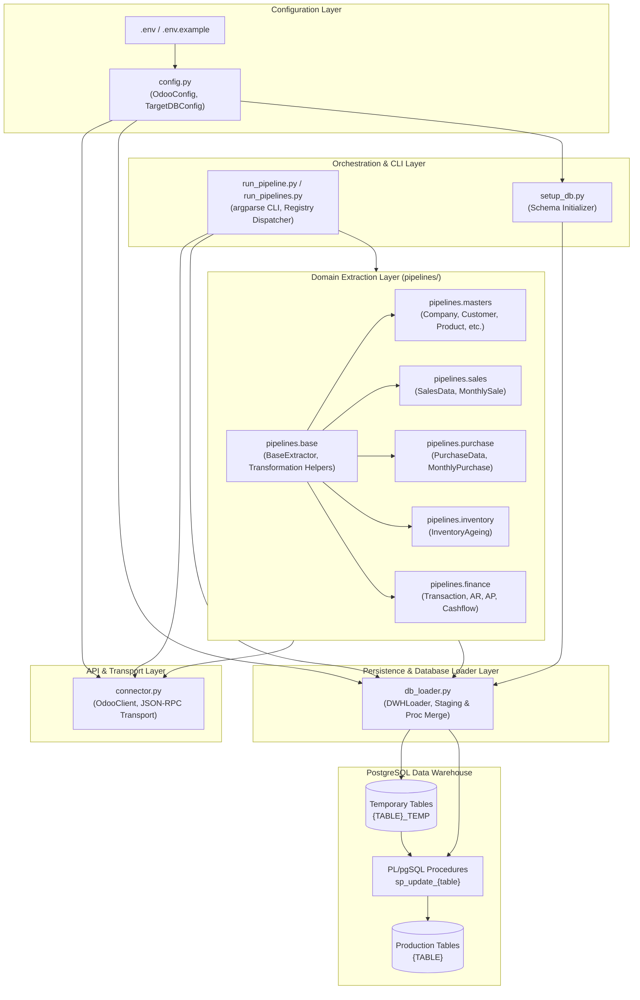

# 02 — Architecture and Components

## 1. Architectural Style & Design Patterns

The pipeline implements an **Extensible Layered ELT Architecture** governed by the **Registry Pattern** and **Template Method Pattern**. 



### Core Design Patterns Evidenced in Code:
1. **Template Method Pattern (`pipelines/base.py`)**:
   `BaseExtractor` defines the template method `run(client, loader=None)`. Subclasses implement `extract(client)` to handle source querying and schema transformation, while `BaseExtractor` governs execution timing, record counting, status logging, and handoff to the database loader.
2. **Registry Pattern (`run_pipeline.py`)**:
   `REGISTRY` maps task aliases (e.g. `'sales_data'`, `'customer_master'`) to extractor classes. `DOMAINS` groups them into executable domain bundles (`'masters'`, `'sales'`, `'purchase'`, `'inventory'`, `'finance'`, `'all'`).
3. **Staging & Merge Pattern (`db_loader.py`)**:
   Incoming data avoids touching live target tables directly. Data flows into `{TABLE}_TEMP` via bulk streaming, followed by an atomic stored procedure call executing key-based deletion and clean insertion.

---

## 2. Component Decomposition & Responsibilities

| Component | Primary Files | Architectural Responsibility | Key Dependencies |
| :--- | :--- | :--- | :--- |
| **CLI Orchestrator** | [`run_pipeline.py`](file:///d:/ARYAN%20GUPTA%20OLD%20LAPTOP%20BACKUP/PROJECTS/ODOO%20ERP%20Research/run_pipeline.py), [`run_pipelines.py`](file:///d:/ARYAN%20GUPTA%20OLD%20LAPTOP%20BACKUP/PROJECTS/ODOO%20ERP%20Research/run_pipelines.py) | Parses command-line flags (`--domain`, `--extractor`, `--load`, `--truncate`, `--limit`), initializes clients, coordinates pipeline execution, and prints execution summaries. | `connector.py`, `db_loader.py`, `pipelines/*` |
| **Configuration Manager** | [`config.py`](file:///d:/ARYAN%20GUPTA%20OLD%20LAPTOP%20BACKUP/PROJECTS/ODOO%20ERP%20Research/config.py) | Encapsulates settings for Odoo (URL, DB, User, Secret, Timeout, SSL) and PostgreSQL (Host, Port, DB, User, Password, Schema). | `python-dotenv`, `os` |
| **RPC Client** | [`connector.py`](file:///d:/ARYAN%20GUPTA%20OLD%20LAPTOP%20BACKUP/PROJECTS/ODOO%20ERP%20Research/connector.py) | Low-level JSON-RPC and XML-RPC transport layer. Manages session authentication (`common.authenticate`) and model queries (`execute_kw`, `search_read`, `search_count`). | `requests`, `config.py` |
| **Base Extractor Framework** | [`pipelines/base.py`](file:///d:/ARYAN%20GUPTA%20OLD%20LAPTOP%20BACKUP/PROJECTS/ODOO%20ERP%20Research/pipelines/base.py) | Abstract base class `BaseExtractor` and cross-cutting transformation utilities (`get_m2o_id`, `get_m2o_name`, `pad_code`, `safe_num`, `parse_date`). | `connector.py`, `db_loader.py` |
| **Domain Extractors** | `pipelines/masters/*`<br/>`pipelines/sales/*`<br/>`pipelines/purchase/*`<br/>`pipelines/inventory/*`<br/>`pipelines/finance/*` | 18 specialized extractors querying Odoo models, traversing relationships, casting data types, and mapping fields to target DWH columns. | `pipelines/base.py`, `connector.py` |
| **Database Loader** | [`db_loader.py`](file:///d:/ARYAN%20GUPTA%20OLD%20LAPTOP%20BACKUP/PROJECTS/ODOO%20ERP%20Research/db_loader.py) | Manages PostgreSQL connection lifecycle, table truncation (`truncate_table`), bulk staging insertions via `execute_values`, and stored procedure invocation. | `psycopg2`, `config.py` |
| **Schema Initializer** | [`setup_db.py`](file:///d:/ARYAN%20GUPTA%20OLD%20LAPTOP%20BACKUP/PROJECTS/ODOO%20ERP%20Research/setup_db.py) | Parses SQL backup dumps (`DAL_BKP_08042026`), sanitizes meta commands, adapts schema names dynamically, and idempotently provisions tables and stored procedures. | `db_loader.py`, `config.py` |
| **Metadata Tools** | [`fetch_odoo_tables.py`](file:///d:/ARYAN%20GUPTA%20OLD%20LAPTOP%20BACKUP/PROJECTS/ODOO%20ERP%20Research/fetch_odoo_tables.py), [`fetch_table_column_metadata.py`](file:///d:/ARYAN%20GUPTA%20OLD%20LAPTOP%20BACKUP/PROJECTS/ODOO%20ERP%20Research/fetch_table_column_metadata.py) | Offline metadata generators introspecting Odoo models via `fields_get()` to maintain source schema dictionaries (`odoo_tables.csv`, `odoo_table_column_metadata.csv`). | `connector.py` |

---

## 3. Dependency Direction & Layering Rules

The architecture adheres to clean, unidirectional dependency flow:
1. **Low-level Infrastructure (`connector.py`, `db_loader.py`, `config.py`)** has no awareness of specific business domain extractors.
2. **Domain Extractors (`pipelines/*`)** depend only on `BaseExtractor` and the abstract `OdooClient` interface.
3. **Orchestrator (`run_pipeline.py`)** acts as the composition root, instantiating extractors and injecting the `OdooClient` and `DWHLoader`.

```
[run_pipeline.py] (Composition Root)
       │
       ├──► [pipelines/*] (Domain Business Logic)
       │         │
       │         └──► [pipelines/base.py] (Abstract Framework)
       │                   │
       ├──► [connector.py] ◄┘ (Odoo Transport Layer)
       │         │
       ├──► [db_loader.py] (DWH Persistence Layer)
       │         │
       └──► [config.py] (Configuration State)
```

---

## 4. Architectural Decisions Evidenced in Code

1. **JSON-RPC Primary Protocol over XML-RPC (`connector.py:27-54`)**:
   While Odoo natively supports both XML-RPC and JSON-RPC, `OdooClient` uses JSON-RPC over `requests.post(self.url, json=payload)` because JSON parsing in Python 3.11 is significantly faster and lower in memory overhead than XML DOM parsing.
2. **API Keys as Direct Passwords (`connector.py:65`)**:
   `common.authenticate` uses the Odoo user password or API key interchangeably as the 3rd parameter.
3. **Staging Table Isolation by `Call ID` (`db_loader.py:103-115`)**:
   Every batch run generates a unique `CALL_{timestamp}_{uuid[:6]}` string. This guarantees that multiple parallel runs or previous incomplete loads in `{TABLE}_TEMP` do not cross-contaminate.
4. **Stripping `SNAPSHOT_DT` for Staging (`db_loader.py:108`)**:
   Target production tables feature `"SNAPSHOT_DT" timestamp DEFAULT (now())`. However, `{TABLE}_TEMP` tables do not have `SNAPSHOT_DT` columns. `db_loader.py` programmatically strips `SNAPSHOT_DT` from outgoing tuples when inserting into `_TEMP`.

---

## 5. Architectural Deviations & Coupling Notes

- **Coupling to Specific Stored Procedure Names**:
  `db_loader.py` assumes the target database contains stored procedures named `sp_update_{table_name.lower()}`. If procedure naming conventions in the database diverge, the default name must be overridden via `procedure_name`.
- **Global / Class-level Registry**:
  `run_pipeline.py` defines the extractor registry statically. This is simple and reliable, but adding a new extractor requires both creating the extractor class and registering it in `REGISTRY` and `DOMAINS`.

---

## 6. Document Links

- [System Context and Purpose](01-system-context-and-purpose.md)
- [Runtime Flows and Data Flow](03-runtime-flows-and-data-flow.md)
- [Module and Interface Catalog](04-module-and-interface-catalog.md)
- [Developer KT Guide](09-developer-kt-guide.md)

