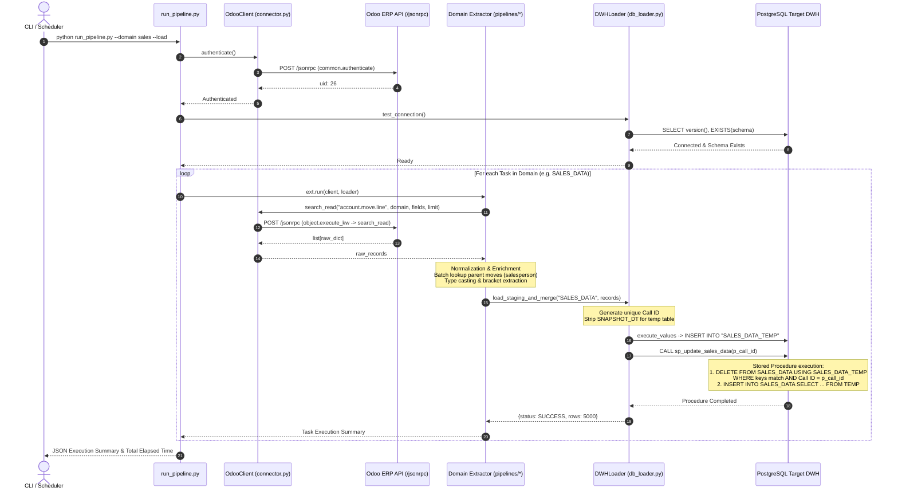
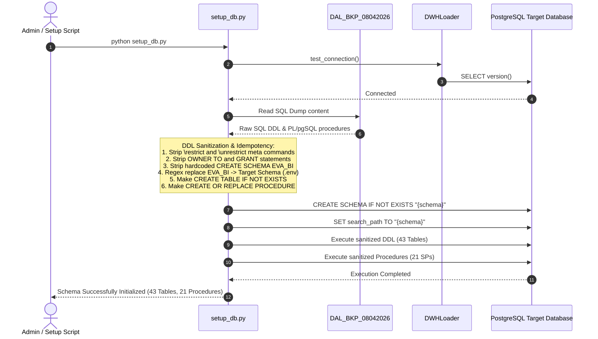

# 03 — Runtime Flows and Data Flow

## 1. Primary Execution Flow: Extractor Pipeline (`--load`)

This flow describes the execution path when a user or scheduler runs `python run_pipeline.py --domain <name> --load`.

### Sequence Diagram

### Step-by-Step Execution Narrative
1. **CLI Invocation**: `run_pipeline.py:main()` parses command-line arguments using `argparse`.
2. **Authentication**: `OdooClient.authenticate()` calls Odoo's `common.authenticate` service with `ODOO_DB`, `ODOO_USER`, and `ODOO_PASSWORD`/API key (`connector.py:59-74`).
3. **Target Connection Check**: If `--load` is enabled, `DWHLoader.test_connection()` verifies connectivity and validates that `TARGET_DB_SCHEMA` exists (`db_loader.py:42-68`).
4. **Task Iteration**: The runner iterates through task names registered in the specified domain.
5. **Data Extraction**:
   - The extractor calls `client.search_read(model, domain, fields, limit, order)`.
   - The query filters by indexed fields (e.g., `parent_state = 'posted'`, `display_type = 'product'`).
   - If auxiliary data is needed (e.g. Salesperson on invoices, GRN pickings on purchase orders), secondary batch lookups query related models in chunks of 500 (`sales_data.py:90-105`).
6. **Data Transformation & Normalization**:
   - Many2one arrays `[id, "Display Name"]` are unwrapped via `get_m2o_id()` and `get_m2o_name()`.
   - Product SKU codes are extracted from bracketed strings (e.g., `"[H1041] HARIBO"` $\rightarrow$ `"H1041"`).
   - Numeric quantities and amounts are normalized; refund records are multiplied by `-1.0`.
   - Dates are parsed and standardized into PostgreSQL timestamp strings (`YYYY-MM-DD HH:MM:SS`).
7. **Staging Table Insertion**:
   - `DWHLoader.load_staging_and_merge()` generates a unique `call_id = f"CALL_{timestamp}_{uuid[:6]}"`.
   - `SNAPSHOT_DT` is omitted from tuple bindings.
   - Rows are streamed into `"{schema}"."{table}_TEMP"` via `psycopg2.extras.execute_values` in batches of 1,000 (`db_loader.py:128-133`).
8. **Stored Procedure Merge**:
   - `CALL "{schema}"."{procedure_name}"(p_call_id)` is invoked inside a database transaction block (`db_loader.py:136-138`).
   - The procedure performs a key-based `DELETE` on the production table matching the staging keys for `p_call_id`, followed by an `INSERT` of the staged rows.
   - The transaction commits atomically. If any error occurs, `conn.rollback()` ensures no corrupted state persists.

---

## 2. Target Database Schema Initialization Flow (`setup_db.py`)

### Sequence Diagram

---

## 3. Truncate-and-Load Flow (`--truncate`)

When the operator specifies `--truncate`:
1. `run_pipeline.py` automatically enables `--load = True`.
2. For each extractor task to be executed, before extraction begins, the runner triggers `loader.truncate_table(ext.target_table)`.
3. In PostgreSQL, `TRUNCATE TABLE "{schema}"."{table}";` and `TRUNCATE TABLE "{schema}"."{table}_TEMP";` are executed atomically.
4. Extraction proceeds, and the fresh dataset is inserted into the empty table.
5. This ensures that any records previously present that no longer exist in Odoo (deletions / cancellations) are purged.

---

## 4. Data Transformation Pipeline & Type Mapping

| Odoo Source Field Type | Transformation / Helper | Target PostgreSQL Type | Example Input | Normalized Output |
| :--- | :--- | :--- | :--- | :--- |
| `Many2one` (Array) | `get_m2o_id(val)` | `integer` / `varchar` | `[34979, "NAIVAS LTD"]` | `34979` |
| `Many2one` (Array) | `get_m2o_name(val, default)`| `varchar` | `[9, "Kizito"]` | `"Kizito"` |
| `Char` (Bracketed SKU) | Custom bracket parsing | `varchar` | `"[H1041] HARIBO"` | `"H1041"` |
| `Float` / `Monetary` | `safe_num(val, default=0.0)`| `numeric` | `None` or `"3287.76"` | `3287.76` |
| `Date` / `Datetime` | `parse_date(val)` | `timestamp` | `"2026-10-31 04:38:27"` | `"2026-10-31 04:38:27"` |
| `Selection` (Refunds) | `* -1.0 if refund else 1.0` | `numeric` | Subtotal `100.0` (out_refund) | `-100.0` |
| `Integer` (Company/Branch) | `pad_code(val, width=2)` | `varchar` | `1` | `"01"` |
| Automatic Audit | Database default | `timestamp` | Database `now()` | `2026-11-02 15:30:21` |

---

## 5. Document Links

- [System Context and Purpose](01-system-context-and-purpose.md)
- [Architecture and Components](02-architecture-and-components.md)
- [Module and Interface Catalog](04-module-and-interface-catalog.md)
- [Reliability and Operations](08-reliability-and-operations.md)

